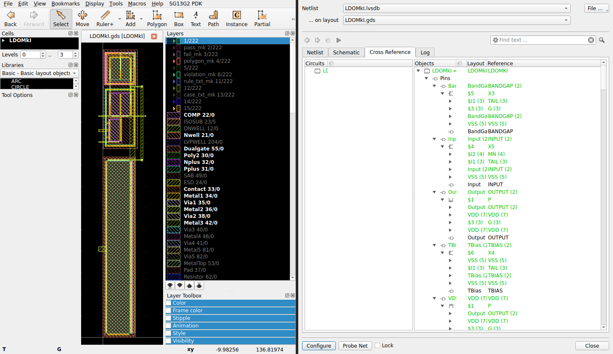
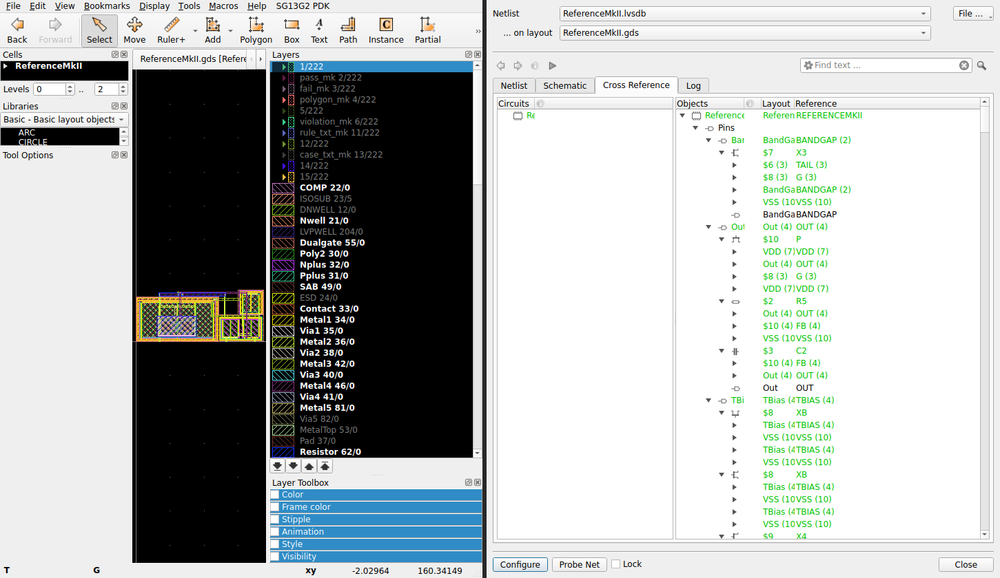

# LVS screenshots 

| Layout | Top cell | File | LVS passed (screenshot) |
|---|---|---|---|
| LDO Mk I | `LDOMkI` | [`Layout/LDOMkI.gds`](https://github.com/rcyaon/cmos-lna/blob/master/Layout/LDOMkI.gds) | ✅ [screenshot](lvs/LDOMkI_LVS_pass.png) |
| Reference Mk II | `ReferenceMkII` | [`Layout/ReferenceMkII.gds`](https://github.com/rcyaon/cmos-lna/blob/master/Layout/ReferenceMkII.gds) | ✅ [screenshot](lvs/ReferenceMkII_LVS_pass.png) |

Please include in each screenshot:

- The LVS result showing the netlists match (KLayout LVS / Netgen summary)
- The cell name and the schematic it was compared against
- Device and net counts for layout vs. schematic

View the layouts: [CMOS LNB layout viewer](https://rcyaon.github.io/cmos-lna/#a=rcyaon%7Cmaster%7CLayout%2FLDOMkI.gds%7CLDOMkI)

## Results (KLayout 0.30.12, GF180MCU LVS deck, variant D)

Both layouts report **"Congratulations! Netlists match."**

| Cell | Compared against | Devices (layout = schematic) |
|---|---|---|
| `LDOMkI` | [`lvs/LDOMkI_lvs.spice`](lvs/LDOMkI_lvs.spice) (from `Schematic/LDO/LDOMkI.sch`) | 6: 3 × pfet_06v0, 3 × nfet_06v0 |
| `ReferenceMkII` | [`Layout/ReferenceMkII_lvs.spice`](../Layout/ReferenceMkII_lvs.spice) | 10: 3 × pfet_06v0, 4 × nfet_06v0, 2 × ppolyf_u_1k, 1 × cap_mim_2f0fF |

### LDOMkI

### ReferenceMkII

Logs, extracted netlists and `.lvsdb` files are in [`lvs/`](lvs/). Re-run with `layout_viewer/lvs/run_lvs.sh`.
